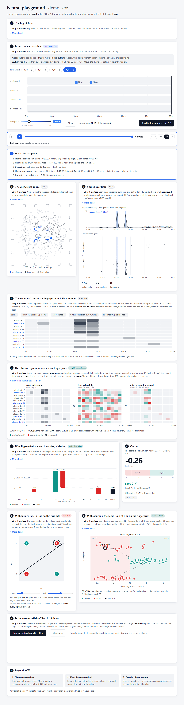
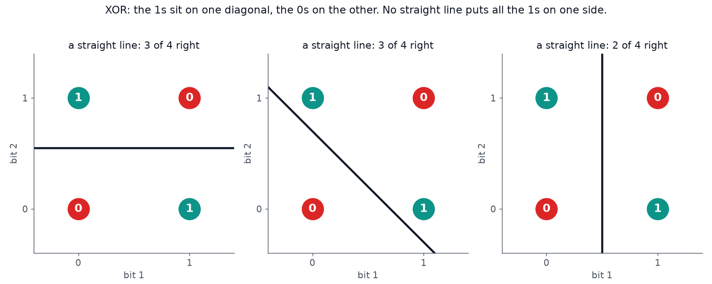
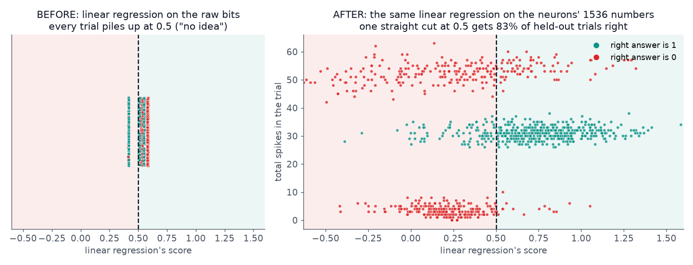

# neural-playground

A testbed for **neural reservoir computing**: encode an input as electrical stimulation, let a fixed network of neurons transform it, and train a simple readout on the network's response. Everything currently runs in simulation using [livn](https://github.com/livn-org/livn), a simulator of neuron cultures on multi-electrode arrays.

The repo has two parts: experiments (task files) and an interactive web playground that runs the simulation and shows every stage of the pipeline. The playground is the best place to build intuition; this README covers what the project does and how it's implemented.

**Live demo:** the XOR playground is hosted at **https://neural-playground-3bsb.onrender.com/**. Each trial runs a real simulation, so a send takes a few seconds.



## Quick start

Requires Python 3.11+.

```sh
git clone <repo URL>
cd neural-playground

python -m venv .venv
.venv\Scripts\activate          # Windows
source .venv/bin/activate       # macOS / Linux

pip install -r requirements.txt
python playground/web.py demo_xor
```

This opens the playground at http://localhost:8765. Pick an input, press **Send to the neurons**, and scroll through the steps. Ctrl+C stops the server. The first run downloads the simulated culture into `systems/`.

| Command | What it does |
|---|---|
| `python tasks/demo_xor.py` | Runs the XOR experiment: trains, tests, compares against the baseline, shows spike rasters |
| `python playground/web.py <task>` | Opens the playground for any task in `tasks/` |
| `python playground/web.py <task> --retrain` | Retrains that task's saved readout |

## Approach

```
input → encoding → electrical pulses → neurons (reservoir) → spikes → decoding → features → readout → output
```

The network of neurons, the **reservoir**, is never trained. It's a fixed recurrent system that reacts to whatever it receives. Each trial:

1. **Encode** the input as pulses on the electrodes.
2. **Record** the network's response through the same electrodes.
3. **Decode** the response into a fixed-length feature vector.
4. **Read out** the answer with a linear model trained on those features.

| Fixed | Trained |
|---|---|
| neurons, wiring, synapse strengths | readout weights only |
| encoding (input → pulses) and decoding (spikes → features) | |

The question is whether the reservoir turns the input into a representation a *linear* readout can use. The readout is kept linear deliberately: if a more powerful model solved the task, it wouldn't be clear that the neurons contributed anything. The structure also maps directly onto hardware: encoding is the stimulator, decoding is the recording setup, and the reservoir could be a real culture instead of a simulated one.

## Why XOR first

XOR ("is exactly one of the two bits on?") isn't linearly separable. The 1s and 0s sit on opposite diagonals, so no single straight line separates them, and linear regression fit on the raw bits outputs 0.5 for every input.



If a linear readout solves XOR after the reservoir, the reservoir must have produced the missing nonlinear feature ("were both bits on?"). The bits are presented **sequentially**, so the network also has to retain a trace of bit 1 when bit 2 arrives. One task tests both nonlinear mixing and short-term memory.



On held-out trials, the readout on the reservoir's features reaches **80–90% accuracy** (90% on the demo's test split); the same linear regression on the raw bits stays at chance.

**Timing is the key design parameter.** The reservoir only helps if bit 2 arrives while the network is still responding to bit 1. Right after a burst, many neurons are refractory and synapses are partly depleted, so the second burst is weaker and involves a different set of electrodes. That difference is the "both bits on" signal. With a 30 ms gap the network recovers completely, the response is just the sum of two independent bursts, and accuracy drops to chance.

| Gap between bits | 3 ms | **6 ms** | 10 ms | 30 ms |
|---|---|---|---|---|
| Accuracy (quick sweep) | ~75% | **~90%** | ~71% | ~60% |

## Implementation

### Simulation (livn)
- **Network:** livn's predefined `EI` culture (excitatory and inhibitory neurons), restricted to a ~300-neuron central patch with `env.selection(300, method="patch")`. A 60 ms trial takes about 1 s; a 200 ms trial on the full ~2,600-neuron culture takes over 30 s.
- **Backend:** livn's `native` backend, a C implementation of its neuron model that matches the NEURON backend spike for spike. It ships precompiled with `pip install livn`.
- **Electrodes:** livn's simulated 128-electrode array. `env.cell_stimulus(...)` maps electrode currents to per-neuron stimulation; `env.channel_recording(...)` groups spikes by electrode.
- **Trials:** one fixed network is reused for every trial. `env.clear()` resets it and draws fresh background noise, so trials are independent and noisy, like repeated recordings of the same culture. Each trial is a single `env(decoding, inputs=..., encoding=...)` call.

### XOR task ([`tasks/demo_xor.py`](tasks/demo_xor.py))
- **Encoding** (`TemporalBitsEncoding`, a livn `Encoding`): each input becomes a list of `(time, electrode)` pulses. A 1 is a 1 ms, 40 µA pulse on the electrode that couples most strongly into the patch: bit 1 at 20 ms, bit 2 at 26 ms. A 0 is no pulse.
- **Decoding** (`BinnedChannelCounts`, a livn `Decoding`): spike counts per electrode in 5 ms windows over the 60 ms trial, 128 × 12 = **1,536 features**. Decoding is per electrode, not per neuron, because that's what a real electrode array measures.
- **Readout:** scikit-learn `LinearRegression`, thresholded at 0.5, trained on 100 trials (25 per input) with a 70/30 train/test split.
- **Baseline:** the same readout trained on the raw bits.

### Task files ([`tasks/`](tasks))
Each experiment is a single file with nine sections: settings, task definition, data generation, encoding, decoding, reservoir, feature collection, readout and evaluation, main. `demo_xor.py` is the reference implementation. `template_task.py` has the same structure with TODOs and a planning block (task, input, encoding, decoding, hypothesis, metric).

To add an experiment, copy the template into `tasks/`, fill in the plan and TODOs, and run it with `python tasks/my_task.py`. It works in the playground (`python playground/web.py my_task`) as long as it defines `INPUTS`, `target()`, `TRIAL_MS`, `make_dataset()`, `build_reservoir()`, `strongest_electrodes()`, `make_pipeline()`, `collect_trials()`, and an encoding with a `pulses(input)` method. The template includes all of these.

The playground page is generic: every section has default text, and the "best straight line on the raw inputs" baseline is computed per task (75% for XOR, 100% for a linearly separable task). A task can optionally define a `PLAYGROUND` dict to replace any section's text with task-specific explanations (tagline, encoding, things to try, and so on). `demo_xor.py` uses it for the XOR walkthrough; `template_task.py` lists the available keys.

### Playground ([`playground/`](playground))
- **`web.py`:** a standard-library HTTP server that holds one livn network and the trained readout. Endpoints: `GET /api/setup`, `POST /api/run` (one trial with user-drawn pulses), `POST /api/repeat` (the same pulses ×N with fresh noise).
- **`web.html`:** the page, in plain HTML and JavaScript. It visualizes each stage (stimulation timeline, network activity, spike raster, the feature grid, readout weights × features, the score, the raw-bits baseline, repeat-trial consistency), with playback to scrub through a trial.
- The readout is trained once and saved to `playground/saved_<task>.pkl`. The XOR readout is committed so a fresh clone or hosted copy starts immediately. Retrain with `--retrain` after changing a task's encoding, decoding, timing or network size.

#### Playground scope

The playground is built around the task-file format above and works for any task within these limits:

- **One task per server.** `python playground/web.py <task>` serves that task only; there's no switching between tasks on the page.
- **Yes/no answers.** The readout output is thresholded at 0.5. Tasks with three or more classes would need the output, waterfall and comparison plots extended.
- **Pulse encodings.** Inputs must be expressible as `pulses(input) → [(time_ms, electrode), ...]` with 1 ms pulses at the encoding's `amplitude_ua`. Other stimulus types (continuous currents, optogenetics) aren't supported.
- **Up to 4 electrodes on the timeline.** The page shows the electrodes the task uses plus the strongest neighbours, capped at 4 lanes.
- **Electrode × time-window features** for the fingerprint, weights and votes panels. Other decodings still run, but those panels show a placeholder.
- **Inputs as tuples of numbers.** The raw-input baseline is drawn as a square with a movable line only for 2-input tasks; other tasks get a list of scores.
- **Linear regression readout**, trained once per task and saved to `playground/saved_<task>.pkl`; retrain after changing the task.
- **Trials up to 1 s**, run one at a time on a single shared network. First-time training blocks the server until it finishes.

Going past these (multi-class outputs, selecting between tasks in the page, other stimulus types) means extending `web.py` and `web.html` or restructuring the playground.

### Hosting
When the `PORT` environment variable is set (as on Render), `web.py` listens on `0.0.0.0:$PORT` and doesn't open a browser; local behavior is unchanged. For Render: build command `pip install -r requirements.txt`, start command `python playground/web.py demo_xor`, environment variable `PYTHON_VERSION=3.12`. Each trial is a full simulation, so small instances are slow.

### Versions
`requirements.txt` pins exact versions: the committed readout was trained with that scikit-learn version, and livn is pinned to `2.0.0` because its GitHub `main` and documentation are ahead of the PyPI release.

## Next steps

- **More tasks on the same pipeline:** delayed memory, parity, sequence discrimination across electrodes, pulse counting, frequency discrimination, and spatial patterns across electrodes (a toy olfaction task; the fruit-fly mushroom body is itself a fixed random expansion with a simple readout).
- **Readouts:** ridge regression for more stable single-trial predictions, multi-class outputs, and rejection of unfamiliar inputs.
- **Robustness:** training with timing jitter and shifted inputs for position-invariant recognition, and systematic sweeps over gap, strength and electrode.
- **Reservoirs:** larger and custom cultures via livn's system generator; the `neuron` backend for large networks and `diffrax` for differentiable simulation (e.g. optimizing the stimulation itself).
- **Beyond fixed reservoirs:** closed-loop control through livn's Gymnasium interface, and synaptic plasticity (`env.enable_plasticity()`).
- **Real cultures:** the encode/decode split mirrors a physical electrode setup, so the same experiment structure should transfer to recordings from real cultures.

The structure will likely change as these are added: task files may become configurations, readouts and decoders swappable components, and experiments tracked systematically.

## Layout

```
neural-playground/
├── README.md
├── requirements.txt
├── tasks/
│   ├── demo_xor.py              XOR experiment (reference)
│   └── template_task.py         starting point for new experiments
├── playground/
│   ├── web.py                   server: livn simulation + readout
│   ├── web.html                 the page
│   └── saved_demo_xor.pkl       trained XOR readout
└── docs/                        README images
```

`systems/` (livn's network data) and `.venv/` are local only and not tracked.
