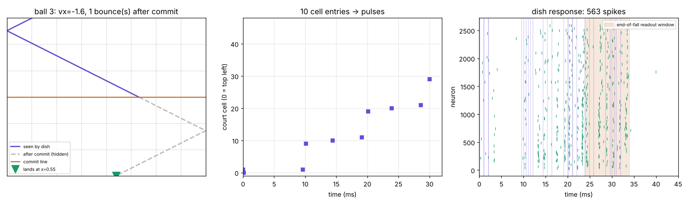

# Reservoir Pong

A ball falls through a box, drifts sideways, bounces off the walls, and lands
somewhere along the bottom. The dish watches the first half of the fall as a
sequence of pulses, one per grid cell the ball enters. At the halfway line the
paddle has to commit. A linear readout on the dish's spikes guesses the landing
spot. The question: does the dish's response carry more about where the ball
will land than the raw pulse list does?



Left: the ball's path. Solid purple is what the dish sees, dashed grey is after
the commit line and hidden. Middle: the pulses the dish receives, one per cell
entry. Right: the dish's spikes, with the readout window shaded.

## Run it

```sh
source .venv/bin/activate

# 1. game only, no dish. picks the difficulty. ~10 s
python pong/baseline.py

# 2. look at one ball (path, pulses, spikes). ~20 s. change the number for a different ball
python pong/show_ball.py 3
python pong/show_ball.py 11 --nodish      # skip the simulation, just path + pulses

# 3. the experiment. 400 balls, ~12 min. prints dish vs baseline vs shuffled
python tasks/pong_task.py
```

Output of step 3 is a table like the one in `results/pong_runs.md`.

## Files

| file | what |
|---|---|
| `pong/game.py` | ball physics, grid, pulse events, commit height. no neurons |
| `pong/baseline.py` | linear readout on raw pulses at three commit heights. the no-dish check |
| `pong/show_ball.py` | draws one ball |
| `tasks/pong_task.py` | the experiment, in the 9-section template format |
| `results/pong_runs.md` | all runs so far and what was found |

## Setup

- 8 wide x 6 tall court mapped onto a contiguous 8x6 block of electrodes (48 of 128)
- ball falls in 60 ms, sideways speed random up to 3 court-widths per fall
- paddle commits at half height, so the readout sees ~30 ms, 6 to 10 pulses
- each cell entry = 3 biphasic pulses, 1 ms apart, 40 uA
- readout: ridge regression. features are spike counts per court electrode per 3 ms bin over the whole fall
- baseline: same ridge on the last 6 cells entered (x, y, time gaps), 17 numbers, no dish
- catch = prediction within one cell width of the true landing. chance is ~25%

## Result so far

| readout | catch | straight balls | bouncing balls |
|---|---|---|---|
| shuffled labels | 27% | 30% | 25% |
| baseline, no dish | 31% | 36% | 29% |
| dish | 32% | **43%** | 26% |

The dish beats the baseline on balls that go straight after commit. That means
it reads direction and speed off the pulse timing, better than a hand-written
summary of the last six cells does. It does not beat the baseline on balls
that bounce after commit. The bounce happens after the dish stops watching,
and walls are not encoded, so there is nothing in the dish's state about the
wall. A linear readout can extrapolate a straight line from velocity but can't
fold it at a wall it never heard about.

## How it got here

Things found by running it, not by planning. Full detail in `results/pong_runs.md`.

1. First setting (faster ball) saturated the dish: 25 pulses in 30 ms, 500+
   spikes then silence. Every readout at chance. Slowed the ball.
2. The spec's readout window (skip a blind phase after the last pulse, then
   read) was empty. The dish is exhausted by then. Window moved to cover the
   response to the last pulses, then widened to the whole fall.
3. Probed the dish with two paths ending at the same cell. Same final pulse,
   87 vs 97 spikes depending on which way the ball came. So it does encode
   history. But the per-column direction signal was 0.3 spikes, too small to
   read in one trial.
4. Three pulses per cell instead of one deepened the recovery and made the
   direction signal 2.3 spikes. That is what got the dish past the baseline
   on straight balls.

## Next

Put the bounce before the commit line (faster ball, or lower commit) so wall
contact is in the dish's state. That is the fair test of whether the dish
combines "just bounced" with direction. Also: more balls to shrink the
error bars (3 points at 400 balls is about one standard error).
